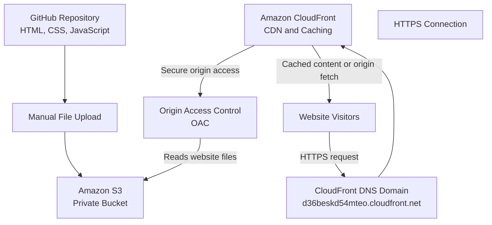

# Harvest Basket - AWS Architecture

## Architecture Overview

The Harvest Basket website is hosted on Amazon S3 and delivered globally through Amazon CloudFront.

GitHub stores the website source code, while the website files are manually uploaded to the private S3 bucket.

## Architecture Diagram

## AWS Components

| Component | Purpose |
|---|---|
| GitHub | Stores website source code |
| Amazon S3 | Stores HTML, CSS and JavaScript files |
| Origin Access Control | Provides secure CloudFront access to private S3 |
| Amazon CloudFront | Global content delivery and caching |
| HTTPS | Encrypts communication between visitors and CloudFront |
| CloudFront DNS | Provides the distribution's public domain name |

## Request Flow

1. Website source code is maintained in GitHub.
2. Website files are uploaded to the Amazon S3 bucket.
3. CloudFront requests website content from S3 using OAC.
4. Visitors access the CloudFront domain through DNS resolution.
5. CloudFront delivers cached content when available.
6. HTTPS protects communication between visitors and CloudFront.

## Deployment Information

- S3 Bucket: `harvest-basket-website`
- AWS Region: `ap-south-1`
- CloudFront Distribution ID: `E2YK00A0XHQ5SD`
- CloudFront Domain: `d36beskd54mteo.cloudfront.net`
- Default Root Object: `index.html`

## Note

A custom domain and separate DNS records have not been configured. The default CloudFront domain is used for public access.
